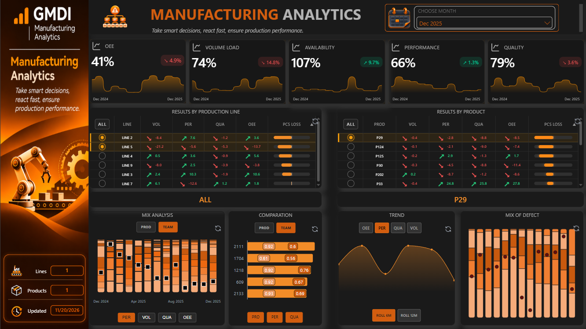

# Automatic Production Line Analytics

### Turning Manufacturing Data into Operational Insights

An end-to-end Business Intelligence solution for analysing automated production lines. Built with SQL Server and Power BI, it brings
production, planning and quality data together to help manufacturing teams understand OEE, identify performance losses and make better operational decisions.

------------------------------------------------------------------------

## 1. The Problem

Production data is generated across different operational areas, but separate reports do not always provide a clear picture of overall performance.

This project addresses five key business questions:

-   What is the OEE of each production line?
-   What is driving low OEE: Availability, Performance or Quality?
-   How does actual production compare with the production plan?
-   Are certain lines, shifts or products performing differently?
-   Where should improvement efforts be focused?

The challenge was not simply to create another dashboard. It was to connect the available data and present it in a way that helps users understand 
production performance and identify where to investigate further.

## 2. The Proposed Solution

I developed a Manufacturing Business Intelligence solution that combines production, planning and quality data in a single analytical model.

-   **SQL Server** organises and transforms source data.
-   **Power Query** prepares data for analysis.
-   **Star Schema** connects production facts with analytical
    dimensions.
-   **DAX** calculates manufacturing KPIs.
-   **Power BI** presents results through interactive dashboards.

The result is a unified view of production performance, from high-level OEE monitoring to detailed analysis by production line, shift and time period.

## 3. How I Approached the Problem

I followed a structured process, starting with the business problem and translating it into an analytical solution.

### Step 1 -- Understand the Production Process

I focused on the automated production process and the information needed to evaluate its performance. The analysis brought together three main data areas:

-   Production -- actual output and production activity.
-   Planning -- planned production and available capacity.
-   Quality -- produced quantities and scrap.

### Step 2 – Define the KPIs

I used OEE as the central performance indicator and separated it into its three components:

| KPI | What it measures |
|---|---|
| **Availability** | How much of the planned production time was available for production. |
| **Performance** | How actual production compares with the theoretical production rate. |
| **Quality** | The proportion of produced units that meet quality requirements. |
| **Volume Load** | How much of available capacity is planned to be used, directly connected to client calloffs. |
| **OEE** | Overall Equipment Effectiveness, combining Availability, Performance, and Quality. |

Additional measures include production quantity, scrap and production load.

### Step 3 -- Prepare and Connect the Data

I organised source data using SQL views and prepared it for reporting. The data model follows a Star Schema approach, allowing production
results to be analysed consistently by line, shift and date.

### Step 4 -- Build the Analytical Solution

I developed interactive Power BI report to answer the original business questions.

**OEE summary** -- provides a high-level view of manufacturing performance, including KPI cards, production line details, 
product details, teams, tools, products performance.

### Step 5 -- Analyse the Results

After developing the model and dashboards, I analysed the results to identify performance patterns and areas requiring further investigation.
This connected the technical solution back to the original business problem: understanding not only the KPI result, but also where
performance differences occur and what factors may be associated with them.

## 4. Key Findings

-   OEE remained below the world-class benchmark across all analysed production lines.
-   Volume Load showed a positive trend in last 4 months.
-   Availability remains stable as there is no detailed run time tracking.
-   Performance and Quality were the main contributors to low OEE and showed negative trends over the observed period, which started from June 2025.
-   June 2025 is recognized as starting point of drop of Performance and Quality
-   **Line 2** 
		- Showed the highest production loss.
		- Performance dropped by 19% in Jun 2025.
		- Significant change in Team Mix at the same period.
		- Significant difference in Quality performance between production teams. Team 1704 has 30% lower performance comaring to others
		- There is clear correlation between Line Performance and Production volume of product P124.
-   **Line 5**
		- Second contributor in production loss.		 
		- Performance drop started from Feb 2025.
		- There is clear correlation between Line Performance and Production volume of product P202.
		- Quality performance of product P202 has constant negative trend. There is correlation with increase of defect D9.
-   **Line 4**
		- Third contributor in production loss.
		- Performance and Quality dropped since Jun 2025.
		- Significant difference in Performance between production teams. Team 569 has 15% lower performance comaring to others.
		- There is change in product mix at the same period. Increase of share of volume for product P27.
		- Product P27 have increase of defect D24 in the last month.
-   **Line 9**
		- Fourth contributor in production loss.
		- Constant negative trend in Performance since Mar 2025.
		- Team mix is significantly high on this line. 	
		
These observations indicate possible relationships between production
performance, product mix and workforce organisation. Further investigation is required to establish root causes; correlation alone does not prove causation.

## 5. Recommended Improvement Areas

-   Investigate the causes of the Performance and Quality decline observed from Jun 2025.
-   Analyse products P124,P202 and P27 to understand their impact on production performance, including tooling complexity, product design and line compatibility.
-   Review workforce allocation and employee movement between production lines.
-   Evaluate operator training, onboarding and polyvalence management.
-   Consider a structured operator qualification and certification process.
-   Use regular KPI review meetings to monitor performance and follow up improvement actions.
-   Develope production time and down time data collection in order to investigate Availability in more details.

## 6. Business Value

The solution provides a consistent analytical view of production performance and supports:

-   Daily production monitoring.
-   OEE and loss analysis.
-   Comparison of actual production with the plan.
-   Capacity and workload monitoring.
-   Scrap and quality monitoring.
-   Structured performance reviews.
-   Data-supported continuous improvement.

The dashboards provide visibility and analytical support. Operational improvements depend on the actions taken by the business and should be measured separately.

## 7. Technology

| Area | Technology |
|---|---|
| Database and transformation | SQL Server, SQL Views |
| Data preparation | Power Query |
| Data modelling | Star Schema |
| KPI calculations | DAX |
| Reporting and visualisation | Power BI |
| Version control | Git, GitHub |
## 8. Documentation

Additional technical documentation is available in the `Documentation`
folder:

-   Solution Architecture
-   Business Logic and KPI Definitions
-   SQL Documentation
-   Data Model
-   Power BI Documentation
-   DAX Measures

## 9. Future Development

Potential next steps include Power BI Service deployment and automated refresh, near real-time reporting.
These are potential enhancements, not features of the current implementation.

------------------------------------------------------------------------

## About

**Miroslav Grujić -- GM Data Insight**

Manufacturing Analytics \| Business Intelligence \| SQL Server \| Power
BI \| Operations Analytics

With more than 18 years of experience in automotive manufacturing and
operations, I combine practical manufacturing knowledge with data and
Business Intelligence capabilities to turn production data into
actionable insights.

-   Website: [gmdatainsight.com](https://gmdatainsight.com)
-   LinkedIn: [Miroslav
    Grujić](https://www.linkedin.com/in/miroslav-grujic-55567578/)

------------------------------------------------------------------------

⭐ Explore other projects in the **GM Data Analytics Portfolio**.

